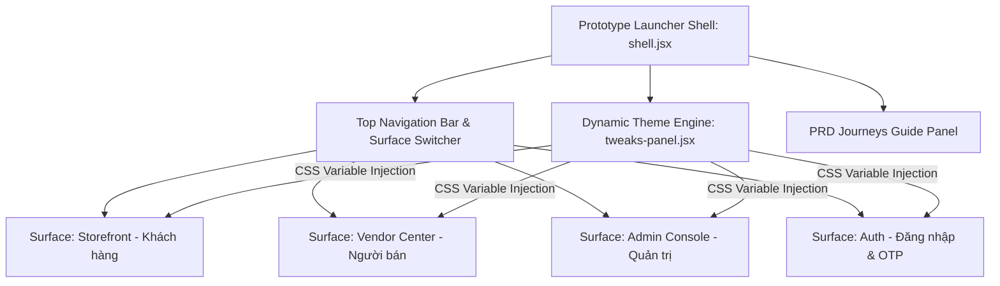
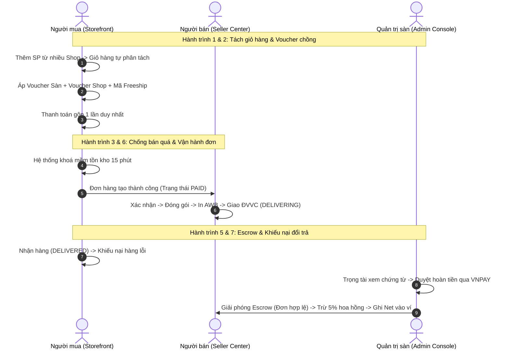
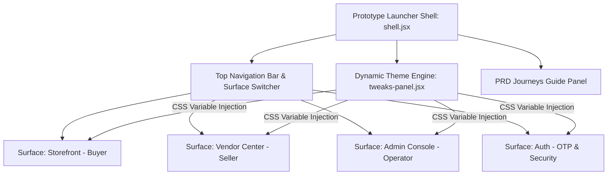
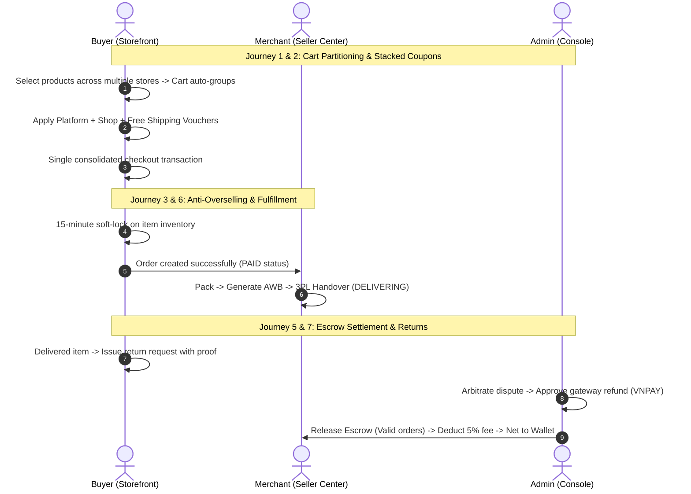

# Lazadee Platform Prototype — Unified Interactive Marketplace Shell

> **Repository:** `multivendor-ecommerce-prototype`  
> **Platform:** Lazadee Multi-Vendor E-Commerce Platform  
> **Language Support:** [Tiếng Việt](#tiếng-việt) | [English](#english)

---

## Mục lục / Table of Contents
- [Tiếng Việt](#tiếng-việt)
  - [1. Giới thiệu tổng quan](#1-giới-thiệu-tổng-quan)
  - [2. Kiến trúc Khung khởi chạy hợp nhất (Unified Shell Architecture)](#2-kiến-trúc-khung-khởi-chạy-hợp-nhất-unified-shell-architecture)
  - [3. Bộ tùy biến giao diện động (Dynamic Theme Engine)](#3-bộ-tùy-biến-giao-diện-động-dynamic-theme-engine)
  - [4. Phân tích 7 Luồng nghiệp vụ PRD Cốt lõi (PRD Journeys)](#4-phân-tích-7-luồng-nghiệp-vụ-prd-cốt-lõi-prd-journeys)
  - [5. Cấu trúc thư mục](#5-cấu-trúc-thư-mục)
  - [6. Hướng dẫn cài đặt & Trải nghiệm](#6-hướng-dẫn-cài-đặt--trải-nghiệm)
- [English](#english)
  - [1. Executive Overview](#1-executive-overview)
  - [2. Unified Shell Architecture](#2-unified-shell-architecture)
  - [3. Dynamic Theme Engine](#3-dynamic-theme-engine)
  - [4. In-Depth Analysis of 7 Core PRD Business Journeys](#4-in-depth-analysis-of-7-core-prd-business-journeys)
  - [5. Directory Structure](#5-directory-structure)
  - [6. Installation & Execution Guide](#6-installation--execution-guide)

---

# Tiếng Việt

## 1. Giới thiệu tổng quan

**Lazadee Platform Prototype** là bộ nguyên mẫu tương tác hoàn chỉnh (High-Fidelity Interactive Prototype) của hệ thống sàn thương mại điện tử đa người bán **Lazadee**. 

Khác với các bản thiết kế tĩnh, dự án này đóng vai trò như một **Khung khởi chạy hợp nhất (Unified Platform Launcher Shell)**, tích hợp toàn bộ các phân hệ người dùng (Khách hàng, Người bán, Quản trị viên, Xác thực bảo mật) vào một môi trường tương tác trực tiếp theo thời gian thực. Hệ thống cho phép kiểm thử toàn diện các luồng nghiệp vụ phức tạp của sàn TMĐT theo sát đặc tả yêu cầu phần mềm (SRS / PRD).

---

## 2. Kiến trúc Khung khởi chạy hợp nhất (Unified Shell Architecture)

Nguyên mẫu vận hành theo mô hình Host-Iframe tương tác hai chiều, cho phép chuyển đổi vai trò người dùng (Persona) tức thì mà không làm mất trạng thái phiên làm việc.



### 4 Phân hệ chính (Surfaces):
1. **Storefront (`#storefront`):** Không gian mua sắm dành cho người tiêu dùng (Trang chủ, Tìm kiếm thông minh, Chi tiết SP, Giỏ hàng đa shop, Thanh toán gộp, Sổ địa chỉ, Theo dõi vận đơn, Quản lý tài khoản, Ví xu, Trung tâm hỗ trợ chat).
2. **Vendor Center (`#vendor`):** Kênh quản trị dành cho đối tác bán hàng (Tổng quan GMV, Quản lý sản phẩm & SKU, Quy trình xử lý đơn & in vận đơn, Hồ sơ định danh KYC, Ví tiền & Sổ cái doanh thu Escrow, Khuyến mãi shop, Phản hồi đánh giá).
3. **Admin Console (`#admin`):** Trung tâm vận hành dành cho ban quản trị và nhân viên sàn (Hàng đợi thẩm định hồ sơ KYC, Hội đồng phân xử khiếu nại & hoàn tiền qua VNPAY, Duyệt lệnh rút tiền Payout, Cấu hình % hoa hồng danh mục, Sổ cái kế toán sàn, Kiểm duyệt nội dung, Quản lý voucher sàn, Phân quyền RBAC, Nhật ký kiểm toán Audit Trail).
4. **Auth & Security (`#auth`):** Phân hệ xác thực tập trung (Đăng nhập số điện thoại/email, Xác thực OTP 6 số tự động focus, Đăng nhập mạng xã hội, Tự động khóa tài khoản sau 5 lần vi phạm mã xác thực).

---

## 3. Bộ tùy biến giao diện động (Dynamic Theme Engine)

Shell tích hợp bộ điều khiển tinh chỉnh giao diện thời gian thực (`tweaks-panel.jsx`), tự động đồng bộ hóa các biến CSS Variables xuyên suốt tài liệu chính và tất cả các iframes con:

### Bảng màu chủ đạo (Accent Color Ramps):
| Mã màu | Tên màu | Thang sắc độ áp dụng (--orange-50 đến --orange-700) |
| :--- | :--- | :--- |
| `#F5511E` | Cam Lazadee (Mặc định) | `#FFF3EE`, `#FFC1A6`, `#FB7440`, `#F5511E`, `#DB3F0E`, `#B53109` |
| `#2563EB` | Xanh Dương Doanh Nghiệp | `#EAF1FE`, `#B7CEF9`, `#5B8DEF`, `#2563EB`, `#1A4FD0`, `#143FA8` |
| `#14B86E` | Xanh Lá Tươi Sáng | `#E6F8F0`, `#BCEDD8`, `#4DD08E`, `#14B86E`, `#0E9A5A`, `#0B7E49` |
| `#6C2BD9` | Tím Cao Cấp | `#F1ECFE`, `#D6C4F7`, `#9460E8`, `#6C2BD9`, `#5A22B5`, `#4A1C95` |

### Chế độ bo góc (Border Radii):
- **Mềm (Soft - Mặc định):** `--radius-sm: 5px`, `--radius-md: 8px`, `--radius-lg: 12px`.
- **Vuông (Sharp):** `--radius-sm: 2px`, `--radius-md: 3px`, `--radius-lg: 4px`.
- **Tròn (Rounded):** `--radius-sm: 10px`, `--radius-md: 14px`, `--radius-lg: 18px`.

---

## 4. Phân tích 7 Luồng nghiệp vụ PRD Cốt lõi (PRD Journeys)

Nguyên mẫu tích hợp bảng hướng dẫn 7 hành trình người dùng quan trọng nhất, đối chiếu trực tiếp với mã yêu cầu nghiệp vụ (SRS/PRD Requirements):



### Chi tiết các kịch bản kiểm thử:

### 1. Tách giỏ đa người bán & Thanh toán gộp (`FR-ORD-02`, `FR-ORD-03`)
- **Nghiệp vụ:** Khách hàng có thể chọn mua sản phẩm từ nhiều shop khác nhau trong cùng một giỏ hàng.
- **Xử lý:** Khi tiến hành đặt hàng, hệ thống tự động tách thành các đơn hàng độc lập theo từng Shop (`vendorId`), tính toán phí vận chuyển riêng biệt cho từng gói hàng nhưng cho phép người mua gộp chung và thanh toán qua một giao dịch duy nhất.

### 2. Mã giảm giá xếp chồng 3 tầng + Xu (`FR-PRO-04`)
- **Nghiệp vụ:** Cho phép áp dụng đồng thời tối đa 3 loại khuyến mãi trong một lượt thanh toán:
  - **1 Voucher toàn sàn:** Giảm % hoặc tiền mặt tài trợ bởi sàn Lazadee.
  - **1 Voucher của từng Shop:** Do từng nhà bán tự phát hành và tài trợ.
  - **1 Mã Miễn phí vận chuyển (Freeship Xtra):** Khấu trừ trực tiếp vào tổng cước vận chuyển.
- **Xử lý:** Thứ tự áp dụng Shop → Sàn → Freeship → Xu (tối đa 50% tiền hàng còn lại). Hệ thống gợi ý bộ mã giảm nhiều nhất và phân bổ giảm giá vào từng dòng sản phẩm để hoàn tiền từng món chính xác.

### 3. Chống bán quá tồn kho (Anti-Overselling & Soft-Lock) (`FR-ORD-03`, `NFR-03`)
- **Nghiệp vụ:** Khi người mua nhấn nút Đặt hàng, tồn kho của sản phẩm sẽ được chuyển sang trạng thái "Khóa mềm" (Soft-lock) trong 15 phút chờ thanh toán.
- **Xử lý ngoại lệ:** Nếu người dùng thanh toán chậm hoặc có tranh chấp tồn kho dẫn đến hết hàng thực tế, giao diện sẽ báo lỗi `LZD-INV-4090`, hướng dẫn người dùng điều chỉnh lại số lượng hoặc hủy mặt hàng hết tồn.

### 4. Định danh Người bán (KYC) & Duyệt hồ sơ (`FR-VND-02`, `FR-VND-03`)
- **Nghiệp vụ:** Người bán phải hoàn tất định danh mới được quyền đăng tải và kinh doanh sản phẩm.
- **Xử lý:**
  - Người bán nộp ảnh chụp CCCD/CMND (mặt trước + mặt sau), Giấy phép kinh doanh / Đăng ký kinh doanh và thông tin thuế.
  - Hệ thống chấm điểm rủi ro tự động (Low / Medium / High Risk).
  - Nhân viên sàn tại Admin Console xem xét hồ sơ: Phê duyệt (`VERIFIED`), Yêu cầu bổ sung chứng từ (`SUPPLEMENT_REQUESTED`), hoặc Từ chối kèm lý do chi tiết (`REJECTED`).

### 5. Cơ chế Tài chính Escrow & Khấu trừ Hoa hồng (`FR-PAY-03`, `FR-PAY-05`)
- **Nghiệp vụ:** Bảo vệ quyền lợi thanh toán của cả người mua và người bán.
- **Xử lý:**
  - Tiền thanh toán của người mua được nạp vào tài khoản ký quỹ trung gian (`Escrow Held`).
  - Khi đơn hàng hoàn tất (người mua xác nhận nhận hàng hoặc hết thời hạn đổi trả 7 ngày), tiền được giải phóng (`RELEASE`).
  - Sàn tự động trích thu phí hoa hồng theo ngành hàng (mặc định 5% cho đồ điện tử), phần doanh thu thực nhận (`Net = Gross - Commission`) được ghi nhận ngay lập tức vào số dư khả dụng (`Available Balance`) của người bán để phục vụ rút tiền (`Payout`).

### 6. Vòng đời Đơn hàng & Giao vận 3PL (`UC-LOG-16`, `UC-LOG-01`, `UC-LOG-02`)
- **Nghiệp vụ:** Quy trình khép kín từ lúc phát sinh đơn đến khi hoàn thành: `PAID` -> `CONFIRMED` (Shop xác nhận) -> `PREPARING` (Đóng gói) -> `READY_FOR_PICKUP` -> `DELIVERING` (Đang giao) -> `DELIVERED` (Đã giao hàng) -> `COMPLETED`.
- **Xử lý:** Tích hợp tạo mã vận đơn tự động với các đối tác logistics (J&T Express, Giao Hàng Nhanh...), cập nhật nhật ký hành trình bưu kiện thời gian thực.

### 7. Khiếu nại, Đổi trả & Hoàn tiền (`UC-SUP-01`…`UC-SUP-04`)
- **Nghiệp vụ:** Người mua tạo yêu cầu Trả hàng/Hoàn tiền trong vòng 7 ngày kèm ảnh và video bằng chứng hàng lỗi hoặc không đúng mô tả.
- **Xử lý:** Admin Console đóng vai trò trọng tài độc lập, kiểm tra chứng cứ của hai bên. Đơn VNPay hoàn qua API cổng thanh toán; đơn VietQR và COD do nhân viên chuyển khoản với nội dung `LZDRF{id}`. Mọi khoản được ghi vào sổ cái tài chính bất biến.

---

## 5. Cấu trúc thư mục

```text
prototype/
├── index.html                  # Điểm khởi chạy Prototype Shell (Nạp Babel, CSS & UI Shell)
├── README.md                   # Tài liệu kỹ thuật chi tiết của repository
└── lazadee/
    ├── shell.jsx               # Khung điều hướng chính, Persona switcher, Quản lý tab & PRD Guide
    ├── tweaks-panel.jsx        # Component tùy chỉnh theme & bo góc thời gian thực
    ├── board.jsx               # Danh mục Artboards phục vụ đồng bộ
    ├── design-canvas.jsx       # Component bổ trợ
    ├── styles.css              # Reset CSS & biến giao diện tổng thể
    ├── _ds_bundle.js           # Bundle các component Lazadee Design System
    ├── assets/
    │   ├── fonts/              # Webfonts cục bộ Be Vietnam Pro & IBM Plex Mono
    │   ├── img/                # Ảnh sản phẩm mẫu & banner
    │   └── logomark.svg        # Logo Lazadee
    ├── components/
    │   └── lazadee-components.css # Component Master Styles
    ├── tokens/
    │   ├── base.css            # Base Tokens
    │   ├── colors.css          # Color Swatches
    │   ├── effects.css         # Shadows & Effects
    │   ├── fonts.css           # Font Face Declarations
    │   ├── spacing.css         # Spacing Scale
    │   └── typography.css      # Typography Scale
    └── ui_kits/
        ├── admin/              # UI Kit Quản trị Sàn (Admin Console)
        ├── auth/               # UI Kit Xác thực & Bảo mật (Auth & OTP)
        ├── storefront/         # UI Kit Người mua hàng (Storefront)
        └── vendor/             # UI Kit Kênh Người bán (Vendor Center)
```

---

## 6. Hướng dẫn cài đặt & Trải nghiệm

### Mở trực tiếp trên Trình duyệt:
- Trình duyệt chặn nạp file JSX qua `file://`, nên hãy chạy bằng máy chủ tĩnh như bên dưới.

### Chạy bằng máy chủ tĩnh Python:
```bash
# Khởi chạy server tại cổng 8000
python -m http.server 8000
```
Mở trình duyệt và truy cập: `http://localhost:8000`

### Điều hướng nhanh qua URL Hash:
- Khách hàng (Storefront): `http://localhost:8000/#storefront`
- Kênh người bán (Vendor Center): `http://localhost:8000/#vendor`
- Quản trị sàn (Admin Console): `http://localhost:8000/#admin`
- Đăng nhập & OTP (Auth): `http://localhost:8000/#auth`

---
---

## 7. Dữ liệu mock & các màn hình bổ sung

Toàn bộ prototype chạy bằng dữ liệu mock ngay trên trình duyệt, không cần backend. Dữ liệu nằm trong `data.jsx` của từng UI kit (`pages-data.js` cho trang chính sách).

| Phân hệ | Bổ sung |
| :--- | :--- |
| Storefront | Hộp chọn voucher (nhập mã hoặc chọn từ danh sách, voucher chưa đủ điều kiện hiện lý do), voucher theo từng shop, mini-cart, xóa nhiều sản phẩm, đổi phân loại trong giỏ, biên nhận theo phiên, trang danh mục, 28 trang chính sách, nhóm đơn cùng phiên, điểm danh Xu, lịch sử và chi tiết voucher, thanh toán VNPay / VietQR / COD, Sản phẩm yêu thích, gợi ý khi tìm kiếm, lọc thương hiệu, chia sẻ link kèm phân loại, tiến độ Flash Sale, nhãn Đặt trước và Shop đang tạm nghỉ, báo cáo đánh giá, đánh giá ẩn tên, chat kèm thẻ sản phẩm / đơn hàng, huỷ đơn có lý do, yêu cầu trả hàng có bằng chứng và khiếu nại lên Sàn, đổi Xu lấy voucher, xóa tài khoản sau 30 ngày |
| Seller Center | Chuông thông báo, Tổng quan xếp việc cần làm lên đầu, đơn theo trạng thái GHN, giấy tờ chứng thực sản phẩm, selfie KYC từ camera, địa chỉ lấy hàng, tin nhắn tự động, tài khoản nhận tiền xác minh tên + OTP, Danh mục toàn sàn, rút tiền có OTP, xác nhận / từ chối đơn, so sánh hãng vận chuyển, phản hồi trả hàng trong 48 giờ, chế độ nghỉ, đăng ký Flash Sale, báo cáo đánh giá, chat hoạt động |
| Admin Console | Tổng quan tài chính, Duyệt Sản phẩm (phân tích AI, hồ sơ pháp lý, phân công nhân viên), Thông báo sàn, trình xem tài liệu KYC, kết quả xác thực tự động, tạo voucher theo danh mục và loại trừ, 3 chức danh nhân viên với 13 mã quyền, Quản lý người dùng, Banner trang chủ, chiến dịch Flash Sale, bộ thuộc tính theo ngành, duyệt chi kèm QR chuyển khoản, phân xử có biên bản, xuất CSV |
| Auth | Đăng nhập bằng mật khẩu hoặc OTP, kiểm tra trùng email khi đăng ký, đăng nhập Google / Apple mô phỏng |

Tài khoản demo: mật khẩu `Genie@123`, mã OTP `123456`. Thêm `?guest=1` vào URL Storefront để xem trạng thái chưa đăng nhập.

Các phần chỉ mô phỏng: mã QR không quét được và không có giao dịch thật, SePay / VNPay / Google / Apple / GHN được giả lập bằng nút hoặc độ trễ, OTP không gửi đi đâu. Bản dịch tiếng Anh áp dụng cho chuỗi giao diện chính; nội dung trang chính sách, dữ liệu mẫu và một số hộp thoại, thông báo vẫn bằng tiếng Việt.

---

# English

## 1. Executive Overview

**Lazadee Platform Prototype** is an enterprise-grade, high-fidelity interactive prototype application representing the **Lazadee Multi-Vendor E-Commerce Platform**.

Unlike static design artifacts, this repository serves as a **Unified Platform Launcher Shell**, orchestrating all 4 key user personas (Buyer, Merchant, Platform Administrator, Authentication Security) in a synchronized, real-time environment. It enables comprehensive verification of mission-critical e-commerce business logic in full accordance with the platform's Software Requirement Specifications (SRS / PRD).

---

## 2. Unified Shell Architecture

The prototype operates via a bidirectional Host-to-Iframe architecture, facilitating seamless persona switching without session loss.



### 4 Unified Subsystems (Surfaces):
1. **Storefront (`#storefront`):** Consumer shopping experience (Personalized Home, Multi-Facet Search, PDP with Variant Matrix, Multi-Vendor Cart, Consolidated Checkout, Stacked Coupons, Address Book, Live Parcel Tracking, Account Center, Coin Wallet, Live Chat Widget).
2. **Vendor Center (`#vendor`):** Merchant operational portal (GMV telemetry, Product/SKU catalog CRUD, Pick-Pack-Ship fulfillment with Airway Bill generation, KYC Onboarding, Escrow Wallet & Settlement Ledger, Store Promotions, Review Responses).
3. **Admin Console (`#admin`):** Platform back-office command center (KYC verification queue, Dispute & Refund arbitration with VNPAY gateway triggers, Merchant payout settlement, Category commission matrix, Financial ledger, Content moderation, Platform voucher campaigns, Granular RBAC, Immutable audit trail).
4. **Auth & Security (`#auth`):** Centralized identity management (Phone/Email authentication, Auto-focus 6-digit OTP verification, Social sign-in, Automated 5-attempt security lockout).

---

## 3. Dynamic Theme Engine

The shell features an integrated live theme customizer (`tweaks-panel.jsx`), dynamically broadcasting CSS variables across the parent document and all loaded child iframes:

### Brand Accent Color Ramps:
| Color Hex | Palette Name | Applied Swatch Ramp (--orange-50 to --orange-700) |
| :--- | :--- | :--- |
| `#F5511E` | Lazadee Orange (Default) | `#FFF3EE`, `#FFC1A6`, `#FB7440`, `#F5511E`, `#DB3F0E`, `#B53109` |
| `#2563EB` | Enterprise Blue | `#EAF1FE`, `#B7CEF9`, `#5B8DEF`, `#2563EB`, `#1A4FD0`, `#143FA8` |
| `#14B86E` | Vibrant Green | `#E6F8F0`, `#BCEDD8`, `#4DD08E`, `#14B86E`, `#0E9A5A`, `#0B7E49` |
| `#6C2BD9` | Royal Purple | `#F1ECFE`, `#D6C4F7`, `#9460E8`, `#6C2BD9`, `#5A22B5`, `#4A1C95` |

### Border Radius Presets:
- **Soft (Default):** `--radius-sm: 5px`, `--radius-md: 8px`, `--radius-lg: 12px`.
- **Sharp:** `--radius-sm: 2px`, `--radius-md: 3px`, `--radius-lg: 4px`.
- **Rounded:** `--radius-sm: 10px`, `--radius-md: 14px`, `--radius-lg: 18px`.

---

## 4. In-Depth Analysis of 7 Core PRD Business Journeys

The prototype incorporates an interactive guided tour traversing the 7 most critical user journeys mapped directly to system requirement identifiers (SRS/PRD Requirements):



### Detailed Scenario Breakdowns:

### 1. Multi-Vendor Cart Splitting & Consolidated Payment (`FR-ORD-02`, `FR-ORD-03`)
- **Business Rule:** Buyers can seamlessly add items from disparate merchants into a unified cart.
- **Execution:** During checkout initiation, the system partitions items into distinct sub-orders keyed by `vendorId`. Shipping fees are calculated per merchant origin while permitting the buyer to settle all packages in a single gateway transaction.

### 2. 3-Tier Stacked Voucher Engine with Xu (`FR-PRO-04`)
- **Business Rule:** Enables concurrent application of up to 3 distinct promotional vouchers:
  - **1 Platform Voucher:** Percentage or fixed discount funded by Lazadee.
  - **1 Shop-Specific Voucher:** Self-funded merchant discount code.
  - **1 Free Shipping Voucher (Freeship Xtra):** Shipping subsidy deduction.
- **Execution:** The calculation engine proportionally distributes aggregate discounts across individual line items to ensure precise partial refund calculations.

### 3. Anti-Overselling & Inventory Soft-Locking (`FR-ORD-03`, `NFR-03`)
- **Business Rule:** Clicking "Place Order" activates a 15-minute soft-lock on product inventory.
- **Exception Intercept:** If stock becomes depleted due to concurrent checkouts before payment confirmation, the system intercepts the transaction with an explicit `LZD-INV-4090` error, instructing the user to update their cart.

### 4. Merchant Onboarding, Identity KYC & Verification (`FR-VND-02`, `FR-VND-03`)
- **Business Rule:** Merchants are restricted from publishing catalog listings until identity verification reaches `VERIFIED` status.
- **Execution:**
  - Merchants submit National ID (Front/Back), Business Registration, and Banking certificates.
  - Automated heuristics assign risk levels (`low`, `medium`, `high`).
  - Compliance officers in Admin Console review documents: Approve (`VERIFIED`), Request Supplemental Documents (`SUPPLEMENT_REQUESTED`), or Reject with explicit feedback (`REJECTED`).

### 5. Escrow Settlement & Commission Deduction (`FR-PAY-03`, `FR-PAY-05`)
- **Business Rule:** Guarantees transactional trust between buyers and sellers.
- **Execution:**
  - Buyer payments are held in an intermediary `Escrow Held` pool.
  - Upon order completion (explicit delivery confirmation or expiry of 7-day return window), escrow funds are released (`ESCROW_RELEASE`).
  - Platform commission fees (default 5% for electronics) are automatically debited, and net proceeds (`Net = Gross - Commission`) are credited directly to the merchant's `Available Balance` for bank withdrawal (`Payout`).

### 6. Order Lifecycle & 3PL Carrier Fulfillment (`UC-LOG-16`, `UC-LOG-01`, `UC-LOG-02`)
- **Business Rule:** Full lifecycle management: `PAID` -> `CONFIRMED` -> `PREPARING` -> `READY_FOR_PICKUP` -> `DELIVERING` -> `DELIVERED` -> `COMPLETED`.
- **Execution:** Automated Airway Bill (AWB) generation with third-party logistics carriers (J&T Express, GHN), providing step-by-step milestone tracking events.

### 7. Disputes, Returns & Refunds (`UC-SUP-01`…`UC-SUP-04`)
- **Business Rule:** Buyers can initiate return claims within 7 days with photo and video evidence.
- **Execution:** The Admin Console serves as an impartial arbitration tribunal, validating both parties' evidence. VNPay orders are refunded through the gateway API; VietQR and COD orders by staff bank transfer with the note `LZDRF{id}`.

---

## 5. Directory Structure

```text
prototype/
├── index.html                  # Prototype Shell Entrypoint (Babel, CSS & UI Shell)
├── README.md                   # Technical Documentation
└── lazadee/
    ├── shell.jsx               # Master Shell, Navigation Gating, Persona Switching, PRD Guide
    ├── tweaks-panel.jsx        # Live Theme & Radius Customizer Component
    ├── board.jsx               # Design Board Catalog Component
    ├── design-canvas.jsx       # Canvas Support Component
    ├── styles.css              # Global Reset & Master CSS Variables
    ├── _ds_bundle.js           # Lazadee Design System Component Bundle
    ├── assets/
    │   ├── fonts/              # Local WOFF2 Webfonts (Be Vietnam Pro & IBM Plex Mono)
    │   ├── img/                # Product Images & Banners
    │   └── logomark.svg        # Lazadee Brand Vector
    ├── components/
    │   └── lazadee-components.css # Component Master Styles
    ├── tokens/
    │   ├── base.css            # Base Variables
    │   ├── colors.css          # Color Swatches
    │   ├── effects.css         # Shadows & Focus Rings
    │   ├── fonts.css           # Local Font Face Declarations
    │   ├── spacing.css         # Spacing System
    │   └── typography.css      # Typography System
    └── ui_kits/
        ├── admin/              # Admin Console UI Kit
        ├── auth/               # Authentication & Security UI Kit
        ├── storefront/         # Buyer Storefront UI Kit
        └── vendor/             # Seller Center UI Kit
```

---

## 6. Installation & Execution Guide

### Native Browser Launch:
- Double-click `prototype/index.html`.

### Static Python Server:
```bash
# Launch server on port 8000
python -m http.server 8000
```
Open `http://localhost:8000` in your web browser.

### Deep Linking via URL Hashes:
- Buyer Storefront: `http://localhost:8000/#storefront`
- Merchant Center: `http://localhost:8000/#vendor`
- Admin Console: `http://localhost:8000/#admin`
- Authentication: `http://localhost:8000/#auth`

---

## 7. Mock data & additional screens

The whole prototype runs on in-browser mock data with no backend. Data lives in each UI kit's `data.jsx` (`pages-data.js` for policy pages).

Demo credentials: password `Genie@123`, OTP `123456`. Add `?guest=1` to the Storefront URL to see the signed-out state.

Simulated only: QR codes cannot be scanned and no money moves; SePay, VNPay, Google, Apple and GHN are stood in for by buttons or delays; OTPs are never sent. English covers the main interface strings; policy page content, mock data and some dialogs and toasts stay in Vietnamese.
